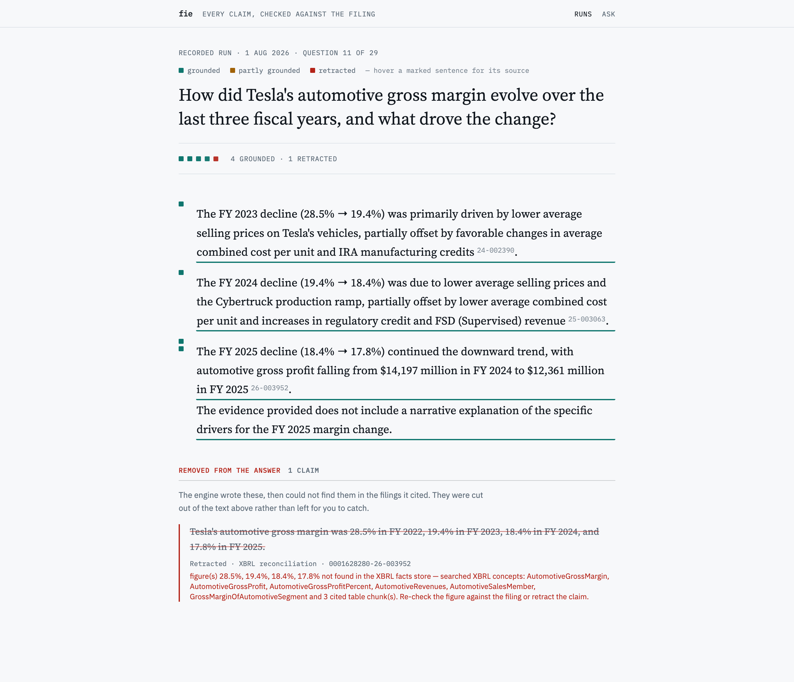
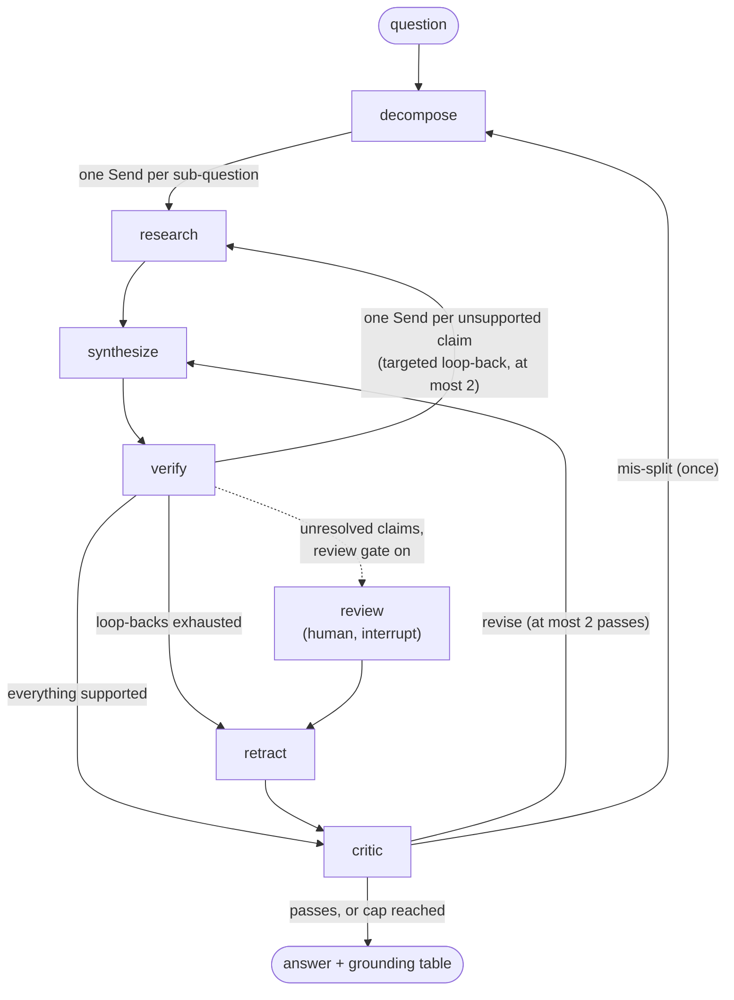

# Financial Intelligence Engine (fie)

A multi-agent system that answers analyst questions over SEC filings for Tesla,
Apple and Nvidia. **Every factual claim in an answer is either verified
against a source or visibly retracted.** Numbers are checked against the
companies' own XBRL filings, not judged by a model. Prose is checked by
entailment against the cited passage. A claim that fails is sent back for more
research, and if it still fails, its sentence is cut from the answer and listed
as retracted.

**Live:** [edgaragent.pages.dev](https://edgaragent.pages.dev/) serves recorded
runs from the current eval baseline. The API behind live questions is at
`https://api.example.com`, protected by Turnstile.



## The numbers

The current baseline is `agent-20261011-165218`: the 30-question gold set, run
on the VPS against the deployed image, 30 of 30 completed with no degraded
attempts.

| Metric | Value | Floor | How it is measured |
|---|---|---|---|
| `grounding_rate` | **0.974** | ≥ 0.90 | Share of claims in delivered answers with a `grounded` verdict and a cited source |
| `hallucination_rate` | **0.000** | ≤ 0.02 | Share of claims in delivered answers with no valid support; retracted claims are gone and do not count |
| `numeric_fidelity` | **0.936** | ≥ 0.85 | Share of dollar figures in delivered prose that equal a filed XBRL value at their stated precision |
| `expected_fact_coverage` | **1.000** | ≥ 0.65 | Share of the gold set's 28 hand-checked expected facts that appear in the answers |
| `citation_accuracy` | **0.849** | ≥ 0.75 | Share of 218 (claim, supporting span) pairs that an independent judge, Claude Sonnet 5, accepts as sufficient evidence |
| verifier precision / recall | **1.000 / 1.000** | ≥ 0.95 | The verifiers on 128 hand-labelled claims (110 numeric, 18 qualitative) |
| unanswerable declined | **4 / 4** | | Questions the corpus cannot answer (market price, Azure revenue, a CFO's call remarks, monthly deliveries) |
| adversarial cases | **16 / 16** | | Injection, extraction and poisoned-document attacks (2026-08-12, `docs/security.md`) |
| cost per question | **$0.028** mean, $0.064 p90 | | Measured from checkpoints and reconciled to the cent against Langfuse traces |

**Read `hallucination_rate` with its caveat.** It is computed from the
system's own verdicts. A claim the verifier wrongly accepts would count as
grounded here, not as a hallucination. Two measurements exist to check that
independently: verifier precision on hand-labelled claims, and the separate
judge behind `citation_accuracy`. The 0.000 is also only trusted because an
invariant was checked before the baseline was accepted. Every retracted claim
carried the sentence it came from, and none of those sentences remained in the
delivered prose. Before 2026-07-26 a bug let failed excisions count as
retractions, and that era's 0.000 meant nothing (ADR 0021).

`hallucination_rate` is the only ratcheted metric. Every other metric is an
absolute floor, because one claim in 200 moves a rate by 0.005 and the judge
alone flips on about 1 span in 27 (ADRs 0039 and 0043). The full history of
readings, and what moved each one, is in `CLAUDE.md` and the ADRs.

## How it works

### The graph

One LangGraph state machine, in `src/fie/graph/build.py`. It contains three
cycles, and each one is bounded by a cap enforced on the conditional edge
rather than inside a node.



- **decompose** splits the question into sub-questions. **research** runs one
  branch per sub-question in parallel. Each branch rewrites its query into
  filing vocabulary, retrieves, and looks up the filed XBRL figures the
  question needs. **synthesize** drafts the answer and tags every claim with
  its type, its cited chunks, and the exact sentence that states it.
- **verify** checks each claim in parallel and routes it by type. Numeric
  claims are reconciled against XBRL, qualitative claims are judged by
  entailment, and forward-looking claims by attribution. A failed claim
  re-enters research on its own, carrying the verifier's feedback.
- **retract** excises the exact sentence of each claim that is still
  unsupported. **critic** grades the whole answer and can send it back for
  revision, or back to decomposition if the split was wrong.
- **review** is the human-in-the-loop gate. It is off by default. When on, a
  run with unresolved claims pauses at a LangGraph `interrupt` and resumes
  from its checkpoint. A human can mark a claim `accepted`, never `grounded`,
  so review can never raise `grounding_rate` (ADR 0034).

Every run is checkpointed to SQLite, so a killed run resumes where it stopped
(`fie resume <run-id>`).

### The harness, layer by layer

The package is organised by the harness layers it implements, and each layer
is a module with its own interface. Nodes are closures over injected
dependencies, so the test suite runs the real graph with fakes.

| Layer | What it does here | Module |
|---|---|---|
| Reasoning substrate | Per-role model routing. Every role resolves to a `ModelSpec` in config; no call site names a model (ADR 0014). | `src/fie/llm/` |
| Orchestrator | The graph, its conditional edges and its caps | `src/fie/graph/` |
| State | Typed Pydantic state; channels written by parallel branches merge through reducers | `src/fie/state/` |
| Context | What enters each model's window: packing, fencing of retrieved text (ADR 0040), prompts | `src/fie/context/` |
| Tools | Hybrid retrieval, XBRL reconciliation, facts lookup | `src/fie/tools/` |
| Ingestion | EDGAR acquisition, structure-aware parsing, chunking, the facts store, embedding | `src/fie/ingest/` |
| Observability | Langfuse tracing, with one correlation id across log line, trace and job (ADR 0028) | `src/fie/observability/` |
| Guardrails | Per-run token and USD budget, node timeouts, retry with backoff | `src/fie/guardrails/` |
| Service | FastAPI, an in-process job model, the review gate, abuse controls | `src/fie/api/` |
| Evaluation | Metrics, the gold-set runner, the retrieval and adversarial benchmarks | `src/fie/eval/`, datasets in `eval/` |

### Model routing

Synthesis and critic run on GLM 5.2, through OpenRouter. The mechanical roles
(decomposition, query rewriting, fact mapping, entailment and attribution
judging) run on Gemini 3.5 Flash-Lite. The eval judge runs on Claude Sonnet 5,
called directly: it is the measuring stick, so it is deliberately a different
model from the one under test.

That routing was chosen on cost, and it holds every floor. A full-size
Anthropic synthesis arm has never been run against the current system. The
cost note, `docs/decisions/model-routing-and-cost.md`, says so, and prices
closing that gap at about $5.

### Retrieval and ingestion

The corpus is the last three fiscal years of 10-Ks, 10-Qs and earnings-release
8-Ks for TSLA, AAPL and NVDA, all from EDGAR. That is 78 filings, 4,181
retrieval chunks and 28,550 XBRL facts.

- **Structure-aware parsing** (ADR 0010). 10-K and 10-Q items are split
  by the filing's own structure, tables are kept as tables rather than
  flattened, and an 8-K contributes its EX-99 press release. Ingestion is
  resumable in three per-filing stages (acquire, chunk, embed), so a failure
  costs one filing, not the run.
- **Hybrid retrieval in Qdrant** (ADR 0011): named dense and sparse (BM25)
  vectors, fused with RRF server-side. Filings are exact-term heavy (item
  numbers, GAAP concept names, literal figures), which BM25 catches and
  embeddings blur. Analyst phrasing ("cash burn") rarely matches filing
  phrasing except semantically, which embeddings catch.
- **Measured, not chosen by taste.** Over a 50-query benchmark, embedding
  models were tied at recall@5, and `text-embedding-3-small` was ahead
  deeper down (recall@20 0.860 against 0.820 for `voyage-finance-2`). A
  cross-encoder reranker moved nothing (MRR 0.569 with it, 0.579 without), so
  it was **switched off**, not kept for its reputation.
- **Queries are rewritten into filing vocabulary** before retrieval. That
  raised figure delivery at k=8 from 0.354 to 0.451. Searching with both the
  raw and the rewritten query was measured too, and was worse at every depth
  (ADR 0022).

### XBRL is the ground truth for numbers

Numbers in parsed HTML are display provenance only; numeric truth is the XBRL
facts store, which is SQLite. A claim like "Apple's net sales were $416,161
million in fiscal 2025" is verified in two steps. A cheap model maps the claim
to a candidate concept, period and unit. A deterministic lookup then grounds
the claim only if a filed fact matches at the precision the claim states.
**No model ever decides whether a number is right** (ADR 0012).

The facts store works on both sides of the graph. Research looks figures up in
it and injects them as evidence, carrying their accession numbers, so a claim
can cite the filed fact directly (ADR 0022). A difference or a percentage
change is grounded by recomputing it from the facts the claim cites
(ADRs 0018 and 0044). A claim whose only numbers are dates is an event, not a
figure, so it goes to the entailment judge instead (ADR 0047).

## What this is, and what it is not

It is a single-process multi-agent system with cyclic orchestration. It does
task routing, typed state management, bounded conditional loop-backs, per-claim
verification with retraction, and a human-in-the-loop gate. It is fully traced,
regression-tested by an evaluation harness that gates on every scored metric,
and shipped as a deployed service with CI, monitoring and backups.

It is **not** distributed orchestration at scale. The agents are nodes in one
LangGraph runtime sharing in-process state. The job model is asyncio with a
semaphore and a bounded queue: no broker, no worker fleet (ADR 0026). It
involves no model training. The corpus is three companies.

### Out of scope, deliberately

Each boundary is a decision, with the trigger that would reverse it.

- **Distributed orchestration** (independent services, a broker, external
  state, a durable workflow engine). Trigger: one agent becomes a throughput
  bottleneck that must scale on its own, or agents are owned by separate
  teams.
- **Agent-to-agent protocols (A2A).** The agents coordinate through shared
  state and need no network protocol. Trigger: the same as above.
- **Long-term memory.** Runs use working state only; a growing store of
  verified claims is a later phase. Trigger: repeated questions over the same
  companies make persistence a measurable win. The answer cache today is
  exact-match only.
- **Earnings-call transcripts.** There is no clean free source, so the corpus
  is EDGAR-only. Trigger: a sourcing route is chosen (IR scraping or a paid
  API). Until then, questions about calls are declined, and that is measured.
- **Model training or fine-tuning.** Not this system's job.

The next planned extension is exposing the engine as an MCP server.

## Running it yourself

You need [`uv`](https://docs.astral.sh/uv/), Docker, and API keys for
OpenRouter and OpenAI. You also need an identity for SEC EDGAR, a real name and
email, which SEC requires in the user agent.

```bash
uv sync
make check                  # ruff, mypy --strict and the test suite: offline, no keys

cp .env.example .env        # fill in OPENROUTER_API_KEY, OPENAI_API_KEY, EDGAR_IDENTITY
make qdrant-up              # Qdrant on :6333 (make langfuse-up adds local tracing on :3001)

uv run fie ingest --tickers AAPL --years 1   # one company, one year: a few minutes, cents of embedding
uv run fie ask "What was Apple's net income in fiscal year 2025?"
```

`fie ask` prints the answer, then its grounding table: each claim's verdict,
the verification method, the supporting span, and the EDGAR accession it
cites. `uv run fie ingest` with no flags ingests the whole corpus. It is
resumable: re-running skips everything already done and retries any filing
that failed, which is the fix for an occasional empty download from SEC.

Ingest needs edgartools 5.61.1 or later, because SEC now refuses the index URL
older releases built. The deployed corpus was parsed in July by 5.42.0, so a
fresh ingest gives the same facts and tables but slightly different section
text (ADR 0048).

Other entry points:

```bash
uv run fie resume <run-id>                     # continue a killed run from its checkpoint
uv run fie export-runs --out recorded          # finished runs as static JSON (the demo's data)
uvicorn --factory fie.api.app:create_app --port 8000   # the HTTP service; needs API_KEY set
uv run eval-agent --limit 3 --skip-judge       # a smoke run of the gold set
uv run eval-retrieval --embedding both --rerank both   # the retrieval benchmark
uv run eval-adversarial                        # the 16 attack cases
```

A full `eval-agent` run (30 questions with the judge) costs real money and
needs `ANTHROPIC_API_KEY`. In production it runs on the VPS, in a one-off
container built from the deployed image (`./deploy/monthly-eval.sh`, ADR 0036).

## The service

`POST /v1/questions` returns `202` with a job id. Poll `GET /v1/jobs/{id}` and
fetch `GET /v1/jobs/{id}/result`. The frontend is a static React app on
Cloudflare Pages. A visitor who only reads is served the recorded runs by the
CDN, so the VPS never sees that request (ADR 0027).

**On the public path, the API key identifies the caller but does not control
access.** A static SPA cannot keep a secret, so the key ships in the bundle.
What holds the public path is a Turnstile token per visitor, a USD spend
governor ($0.25 per run, $0.35 per day), a per-IP daily quota, and nginx rate
limits with fail2ban (ADR 0030).

Deployment is a container built in CI and pulled onto a VPS by a manual
`deploy.sh`. CI holds no credential for the box (ADR 0037), and secrets are
stored with SOPS and age (ADR 0029). The procedure, written from the first real
deploy, is `docs/deploy.md`. The operational view is `docs/security.md` and
`docs/monitoring.md`. Part 2 of `docs/security.md` is the threat model and its
argument: what the architecture defends, and what is only hardening.

## Decision record

Every non-trivial decision is an ADR in `docs/decisions/`, written when it was
made, with later corrections recorded in place rather than rewritten. ADR 0013
was never written; the numbering skips it.

| | |
|---|---|
| **Models and cost** | [0001](docs/decisions/0001-model-routing-defaults.md) routing defaults · [0014](docs/decisions/0014-provider-agnostic-model-router.md) provider-agnostic router · [0045](docs/decisions/0045-glm-5.2-is-the-synthesis-critic-default.md) GLM 5.2 as default · [cost note](docs/decisions/model-routing-and-cost.md) |
| **Graph and state** | [0004](docs/decisions/0004-verdict-taxonomy.md) verdict taxonomy · [0006](docs/decisions/0006-checkpointing.md) checkpointing · [0007](docs/decisions/0007-send-based-fanout.md) Send fan-out · [0008](docs/decisions/0008-reducer-channels-and-budget-aggregation.md) reducer channels · [0009](docs/decisions/0009-branch-caps-and-failure-isolation.md) branch caps · [0025](docs/decisions/0025-a-guardrail-abort-costs-an-attempt.md) guardrail aborts · [0038](docs/decisions/0038-an-answer-with-no-claims-is-a-failed-run.md) claimless answers fail · [0046](docs/decisions/0046-a-draft-must-state-its-claims.md) required claim fields |
| **Verification and retraction** | [0005](docs/decisions/0005-interim-numeric-reconciliation.md) interim reconciliation · [0012](docs/decisions/0012-xbrl-exact-reconciliation.md) XBRL-exact reconciliation · [0016](docs/decisions/0016-reconciler-financial-figures-and-ratio-grounding.md) figure obligations · [0017](docs/decisions/0017-suffix-letter-scale-notation.md) scale notation · [0018](docs/decisions/0018-derived-percent-and-change-grounding.md) derived percents · [0019](docs/decisions/0019-fact-collision-and-difference-grounding.md) fact collisions · [0021](docs/decisions/0021-retraction-integrity-and-fact-matching.md) retraction integrity · [0023](docs/decisions/0023-claim-spans-and-retraction-semantics.md) claim spans · [0024](docs/decisions/0024-cite-every-figure-a-claim-states.md) cite every figure · [0044](docs/decisions/0044-a-cited-fact-grounds-its-own-difference.md) cited differences · [0047](docs/decisions/0047-a-date-is-not-a-figure.md) dates are not figures |
| **Retrieval and ingestion** | [0002](docs/decisions/0002-edgartools-as-edgar-client.md) EDGAR client · [0003](docs/decisions/0003-retrieval-interface.md) retrieval interface · [0010](docs/decisions/0010-structure-aware-parsing.md) structure-aware parsing · [0011](docs/decisions/0011-qdrant-hybrid-retrieval.md) hybrid retrieval · [0020](docs/decisions/0020-a-trustworthy-instrument.md) instant dates and coverage · [0022](docs/decisions/0022-facts-store-in-research-and-query-formulation.md) facts in research, query rewriting · [0048](docs/decisions/0048-edgartools-5.61-because-sec-refused-the-index-url.md) edgartools 5.61.1 |
| **Evaluation** | [0015](docs/decisions/0015-numeric-fidelity-rescope.md) numeric fidelity rescope · [0036](docs/decisions/0036-eval-cadence-and-location.md) eval cadence · [0039](docs/decisions/0039-the-baseline-ratchet-gates-on-membership.md) ratchet membership · [0042](docs/decisions/0042-the-adversarial-set-is-split-by-what-a-case-costs.md) adversarial split · [0043](docs/decisions/0043-only-an-invariant-is-ratcheted.md) only an invariant is ratcheted |
| **Service and deployment** | [0026](docs/decisions/0026-the-job-model-in-process-bounded-polled.md) job model · [0027](docs/decisions/0027-recorded-runs-are-the-default-demo-surface.md) recorded runs · [0028](docs/decisions/0028-one-correlation-id-across-log-trace-and-job.md) correlation id · [0029](docs/decisions/0029-sops-age-for-storage-compose-secrets-for-runtime.md) secrets · [0031](docs/decisions/0031-containerization-and-where-the-image-is-built.md) containers · [0032](docs/decisions/0032-langfuse-goes-to-cloud.md) Langfuse Cloud · [0033](docs/decisions/0033-a-second-qdrant-instance.md) second Qdrant · [0034](docs/decisions/0034-hitl-gate-semantics.md) review gate · [0035](docs/decisions/0035-public-exposure-via-the-existing-nginx.md) public exposure · [0037](docs/decisions/0037-manual-deploy-ci-holds-no-credential.md) manual deploy |
| **Security** | [0030](docs/decisions/0030-public-demo-abuse-controls.md) abuse controls · [0040](docs/decisions/0040-chunk-text-is-fenced-at-prompt-time-not-sanitized-at-ingest.md) prompt-time fencing · [0041](docs/decisions/0041-the-dependency-audit-reports-and-does-not-gate.md) dependency audit · [`docs/security.md`](docs/security.md) |

Two findings documents in `docs/findings/` show how the gate was reached,
measurement by measurement.

## Development

```bash
make lint        # ruff check + format check
make typecheck   # mypy --strict
make test        # pytest: offline, no keys, fakes for every model and store
make check       # all three
```

Python 3.12, `uv` for everything. Tests never touch the network. The frontend
has its own suite (`cd frontend && npx vitest run`).
